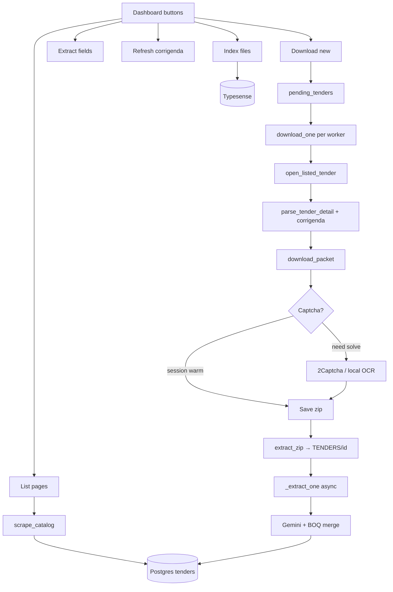

# Handover — Tamil Nadu eProcurement pipeline

Operational map of how listing → captcha download → extract → search hangs together.
Code lives mainly in `app.py` (Playwright scrape/download), `dashboard.py` (jobs + UI), `db.py` (Postgres), `extract_pipeline.py` / `llm_extract.py` (fields), `search.py` (Typesense).

## What this system does

Automates [TN GePNIC closing list](https://tntenders.gov.in/nicgep/app?page=FrontEndListTendersbyDate&service=page):

1. Walk the closing-date list (all pages) and upsert tenders into Postgres.
2. Open each pending tender, pull detail + corrigenda, solve captcha, download the zip packet.
3. Extract zip under `TENDERS/<tender_id>/`, run BOQ + Gemini field merge.
4. Optionally index packet text into Typesense; expose a dashboard + `/api/v1` read API.

## Runtime layout

| Piece | Role |
|---|---|
| `dashboard.py` | FastAPI + uvicorn on `DASHBOARD_PORT` (default **8091**). Single active job at a time. |
| `app.py` | Playwright catalog scrape, tender open, captcha zip download, corrigenda PDFs. |
| `db.py` | Postgres (`DATABASE_URL`). Tender status, captcha usage counters, list-sweep metadata. |
| `docker-compose.yml` | Postgres 16 (`5432`) + Typesense 27.1 (`8108`). |
| `static/` | Dashboard UI (List / Download / Extract / Corrigenda / Index). |
| `temp/` | Zip + captcha PNGs during download (gitignored). |
| `TENDERS/` | Extracted packets per tender id (gitignored). |
| `.env` | Secrets and tunables (gitignored). |
| PM2 | Optional: `ecosystem.config.cjs` process name `tender-dnl`. |

Start deps: `docker compose up -d`  
Start app: `./venv/bin/python dashboard.py` (or PM2).

## End-to-end flow



### 1. List pages (`POST /api/job/list`)

- Opens `LIST_URL` (closing list), reads pager last page.
- **Incremental by default**: stop after `LIST_STABLE_PAGES` consecutive pages with no DB-new IDs, then probe the tail (`LIST_TAIL_PAGES`). Full sweep when catalog empty, page count jumped, `LIST_FULL=1`, or last full sweep older than `LIST_FULL_EVERY_HOURS`.
- Each row → `db.upsert_seen` (`status=seen`, stores `list_page`, closing/published dates, title, org).
- Progress streamed to the UI via WebSocket / job state.

### 2. Download new (`POST /api/job/download`)

- `db.reset_interrupted()` + `db.expire_stale()` (past closing → failed).
- Queue = `db.pending_tenders()`.
- Workers from `resolve_download_workers()` (`MAX_PARALLEL`, optional adaptive).
- Captcha credentials from `captcha_credentials()` — **production path is 2Captcha** (`captcha_provider()` currently always returns `"2captcha"`).
- `download_pending` keeps warm Playwright pages; each item runs `download_one`:

  1. `db.claim(tender_id)` → `downloading`.
  2. `open_listed_tender` — find row on stored `list_page`, ring-search nearby pages if the list shifted.
  3. Parse detail HTML → `details.json` snippet; list/save corrigenda; download corrigendum PDFs when present (may also hit captcha).
  4. `download_packet`:
     - Click **Download as zip file**.
     - If the browser session already authorized, zip may download with **no captcha**.
     - Else fill `#captchaText`, submit, retry up to `CAPTCHA_ATTEMPTS`.
     - On success, click zip again → save under `temp/<id>.zip`.
  5. Extract to `TENDERS/<id>/`, `db.mark_downloaded`.
  6. Kick `_extract_one` on a side pool (Gemini) so the browser worker can take the next tender.

Stop: `POST /api/job/stop` sets `stop_event`; in-flight claims are released where safe.

### 3. Captcha solvers

| Provider | When | Notes |
|---|---|---|
| **2Captcha** | Default / forced in `captcha_provider()` | Needs `TWOCAPTCHA_APIKEY` (aliases `APIKEY_2CAPTCHA`, `TWO_CAPTCHA_API_KEY`). Empty balance stops the download job. |
| **Local OCR** | Code path still present (`ddddocr` + OpenCV denoise + case variants) | Set via env only if `captcha_provider()` is changed back to honor `CAPTCHA_PROVIDER=local`. TN captchas are noisy mixed-case; local OCR alone often needs many retries. |

Captcha image attempts are counted in `truecaptcha_usage` (name is historical; used for any solver). Dashboard **Usage** tab shows daily image counts.

Captcha element selectors on site: `#captchaImage`, `#captchaText`, `#Submit`, refresh `#captcha`. Prefer **element screenshot** over `` (transparent/stale PNG issues).

### 4. Extract fields (`POST /api/job/extract`)

- For downloaded tenders missing merged fields (or forced re-extract):
  - BOQ parse from excel in the packet (`extract_pipeline.parse_boq`).
  - Gemini over preferred PDFs (`llm_extract`, `GEMINI_API_KEY` / `GEMINI_MODEL`).
  - Merge with page + corrigendum history/PDF signals → `details.json`, status toward `extracted`.
- Single-tender: `POST /api/tenders/{id}/reextract`.

### 5. Refresh corrigenda (`POST /api/job/corr_refresh`)

- Revisit detail pages for tenders that may have new corrigendum rows/PDFs without re-downloading the whole zip.

### 6. Index files (`POST /api/job/index`)

- Walk `TENDERS/<id>/`, extract text (pdf/docx/xlsx/…), upsert into Typesense.
- Dashboard search + `/api/v1/search` read from that index.

## Tender status lifecycle

```
seen → downloading → downloaded → extracted
                 ↘ failed
```

- **seen**: listed, not yet claimed for download.
- **downloading**: claim held by a worker.
- **downloaded**: zip extracted on disk.
- **extracted**: field pipeline finished.
- **failed**: error message stored (expired closing, captcha fail, navigation, etc.).

## Key env vars

| Var | Purpose |
|---|---|
| `DATABASE_URL` | Postgres DSN |
| `DASHBOARD_PORT` | UI/API port (8091) |
| `CAPTCHA_PROVIDER` | Intended solver; code currently forces `2captcha` |
| `CAPTCHA_ATTEMPTS` | Max solves per packet |
| `TWOCAPTCHA_APIKEY` | 2Captcha key |
| `MAX_PARALLEL` / `MAX_PARALLEL_MIN` | Download browser workers |
| `DOWNLOAD_ADAPTIVE`, `DOWNLOAD_BACKOFF_*`, `DOWNLOAD_GAP_MS` | Throttle / backoff |
| `LIST_INCREMENTAL`, `LIST_STABLE_PAGES`, `LIST_TAIL_PAGES`, `LIST_FULL`, `LIST_FULL_EVERY_HOURS` | List sweep behaviour |
| `TYPESENSE_*` | Search host/key/port |
| `GEMINI_API_KEY`, `GEMINI_MODEL` | Field extraction |
| `API_KEY` | Optional gate for `/api/v1` (`X-API-Key`) |
| `PLAYWRIGHT_BROWSERS_PATH` | Chromium cache path |

## Dashboard job API (internal)

| Method | Path | Job |
|---|---|---|
| POST | `/api/job/list` | Catalog scrape |
| POST | `/api/job/download` | Packet download + inline extract |
| POST | `/api/job/extract` | Backfill field extraction |
| POST | `/api/job/corr_refresh` | Corrigenda refresh |
| POST | `/api/job/index` | Typesense index |
| POST | `/api/job/stop` | Cooperative cancel |

Live status: WebSocket + `GET`-style job snapshot in UI. External consumers should prefer **`/api/v1`** (see `README.md`).

## Important site quirks

- List is Apache Tapestry; prefer **numbered page clicks** / fetch helpers over “Next” alone (pager can stall).
- Zip download often needs **two clicks**: first surfaces captcha (or reuses session), second after solve starts the file.
- Captcha is **case-sensitive** mixed alphanumeric (~6 chars) with blue speckles + black block noise.
- Closing list drops tenders after closing time — download skips/marks those as left-list / expired.
- Warm Playwright context can skip captcha for subsequent zips in the same session; cold sessions almost always captcha.

## File map (where to change what)

| Concern | File |
|---|---|
| Captcha solve / zip download | `app.py` → `solve_captcha*`, `download_packet` |
| Find tender on list | `app.py` → `open_listed_tender`, `scrape_catalog` |
| Job orchestration / UI API | `dashboard.py` |
| Schema / claims / usage | `db.py` |
| Field merge + BOQ | `extract_pipeline.py` |
| Gemini prompts | `llm_extract.py` |
| Typesense | `search.py` |
| Public read API | `api_v1.py` |
| Front-end controls | `static/index.html`, `static/app.js` |

## Typical operator sequence

1. `docker compose up -d`
2. Ensure `.env` has DB, 2Captcha, Gemini, Typesense.
3. Start dashboard (`python dashboard.py` or PM2).
4. Open `http://<host>:8091` → **List pages** → **Download new**.
5. Watch job detail / Usage for captcha spend; **Stop** if needed.
6. **Index files** when you want search; **Extract fields** to backfill anything download skipped.
7. Export: dashboard export button or `GET /api/v1/export`.

## Known gaps / next risks

- Local OCR path exists but is **not selected** while `captcha_provider()` hard-returns `"2captcha"`; re-enable only after accuracy is acceptable on live TN captchas.
- Captcha usage table is still named `truecaptcha_usage` from an earlier provider.
- Download parallelism vs GePNIC rate limits: prefer modest `MAX_PARALLEL` and watch for transient navigation / captcha storms (`DOWNLOAD_BACKOFF_*`).
- Do not commit `.env`, `temp/`, or `TENDERS/`.
